# Readme
This is a little Rouge Like im working on in my free time. The premise is simple,
it's an RPG with mechanics I feel like adding. It currently is a big playground of 
ideas. 

## Premise
The premise is a lone survivor going up a tower built from flesh and viscera.

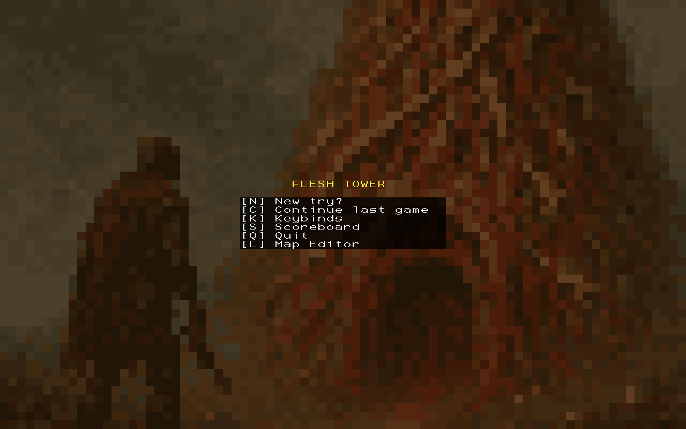


### Info how to play

The Keybinds are a bit convoluted thus there is a screen to inform the player.

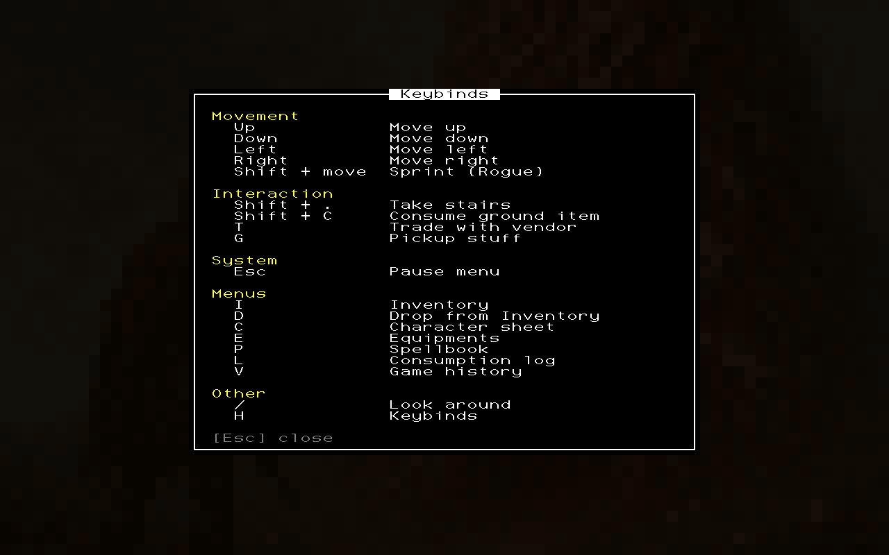

This also works from in game:

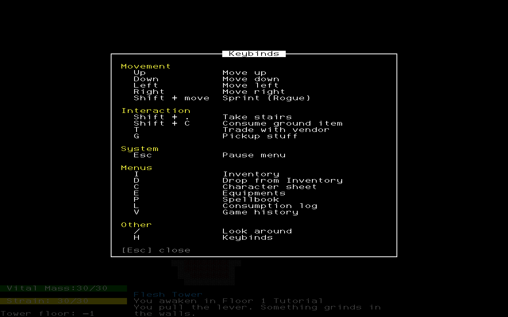

## Level Editor

The game offers a level Editor, accessable from the Main Menu.

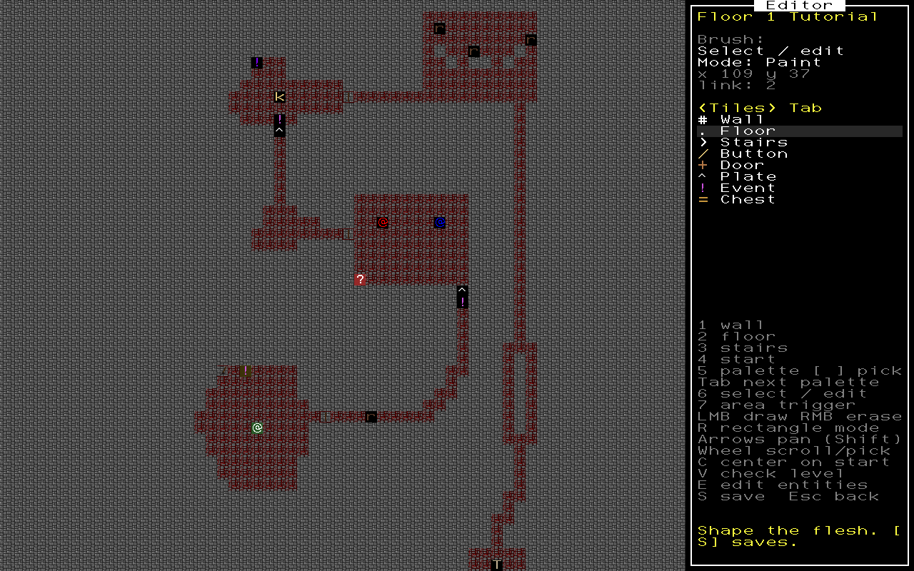

Levels can be createt and edited from the menu:

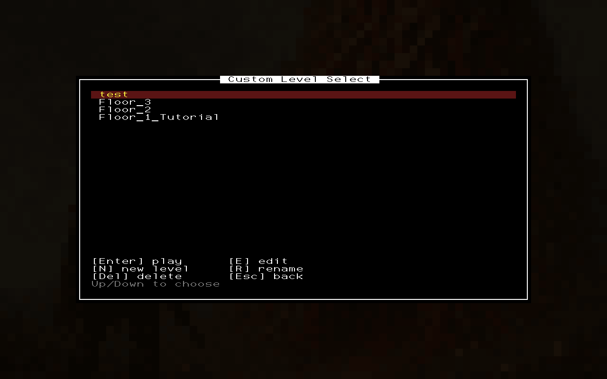

The level editor offers simple level creation.

- Brushes: wall, floor, stairs and player start (1–4); palettes (5, [ ] to switch, Tab for the next palette); select/edit (6); area trigger (7).
- Painting: left click draws, right click erases, R is rectangle mode, the mouse wheel scrolls or picks.
- Validation check if level is completable or missing flags and such


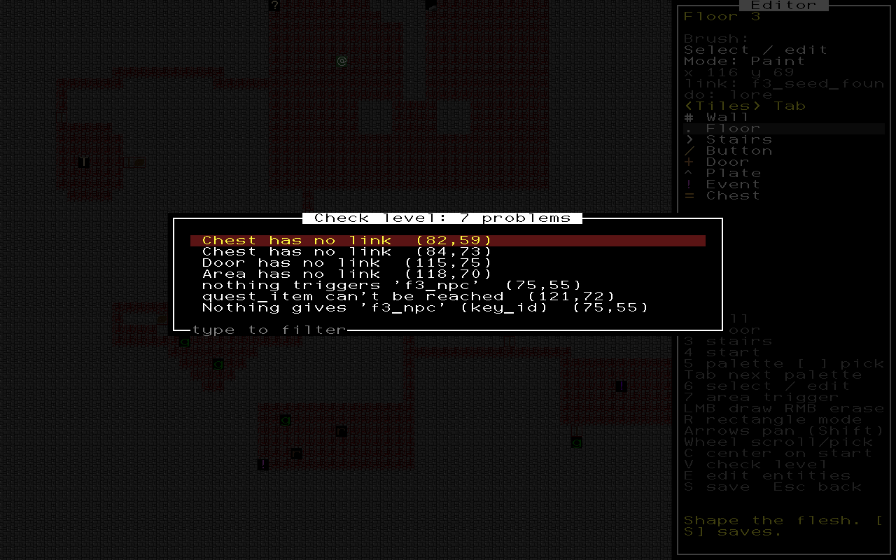

Tiles can have logic, such as chests, doors or pressure plates.

| Chest | Lever |  
| --- | --- |
| 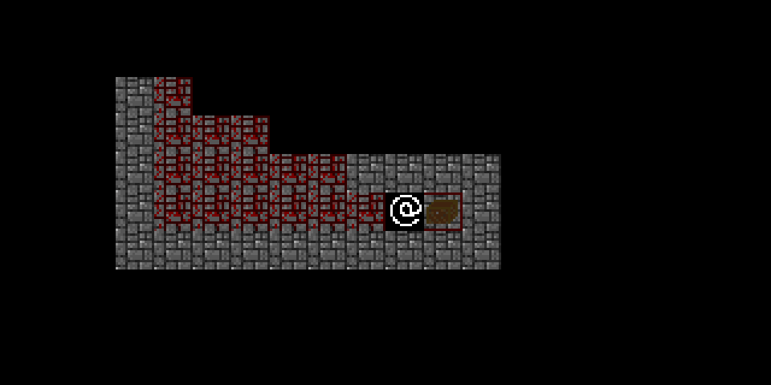| 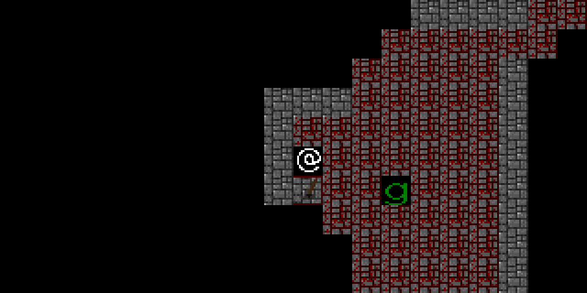|
| 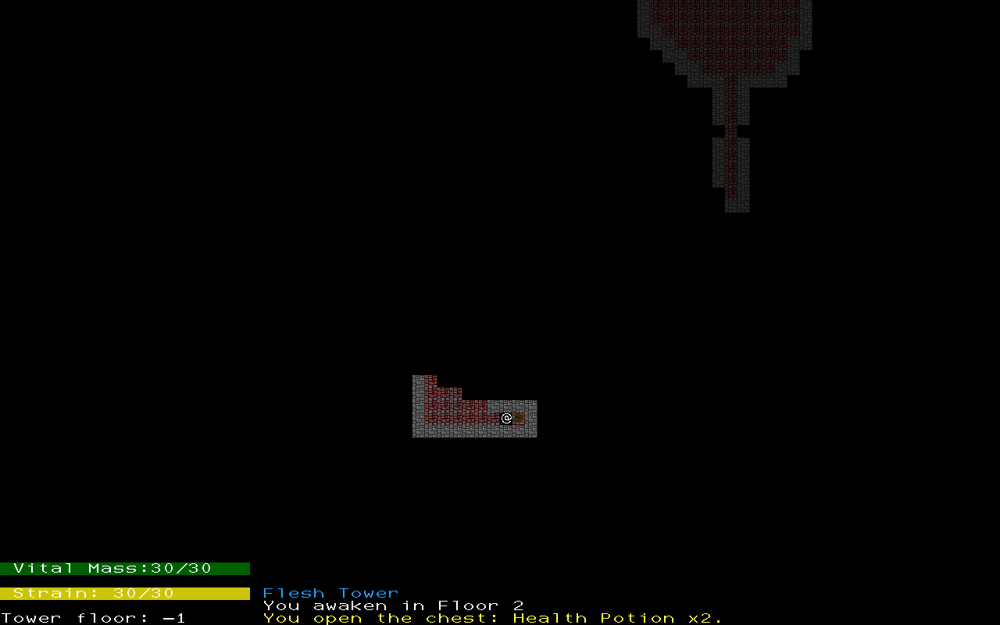 | 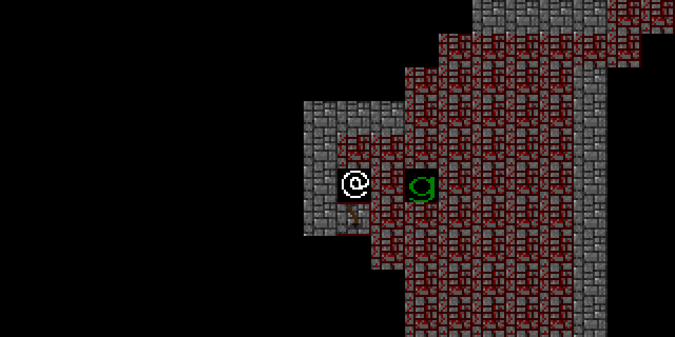


### Properties

The editor can change Properties of entities or tiles paced in game:

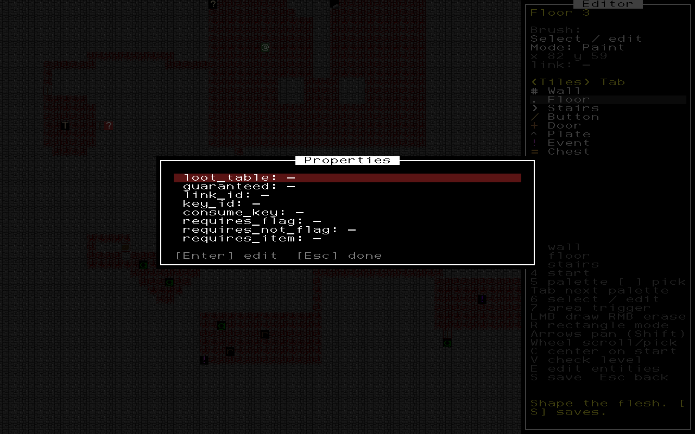

Chests can have Loot tables assigned.

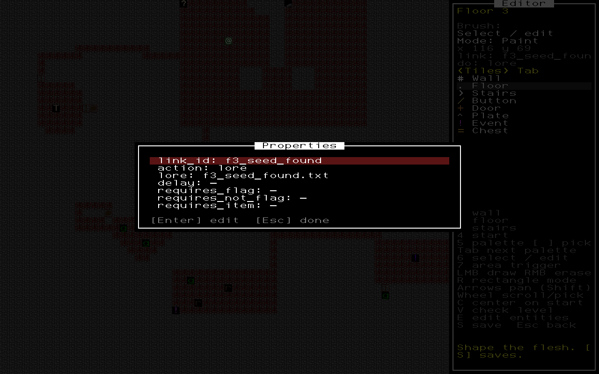

Events can be linked to Levers, death triggers and such. These will trigger if link is called. Events then can trigger many things:

- message
- lore
- spawn
- teleport
- give item
- fire signal
- set flag
- end level

NPC's can also be configured.

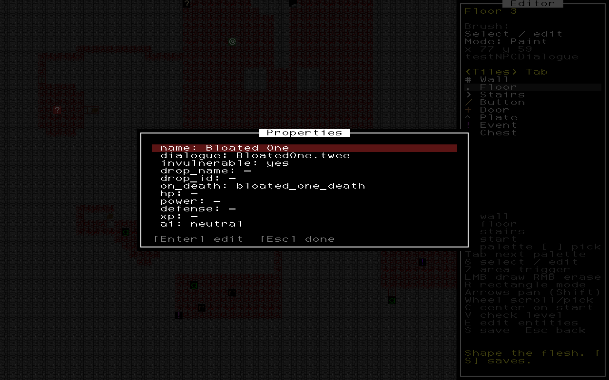

NPC's can have custom dialogue attatched. This is in form of .twee files. Theese files can be produced via Twine.

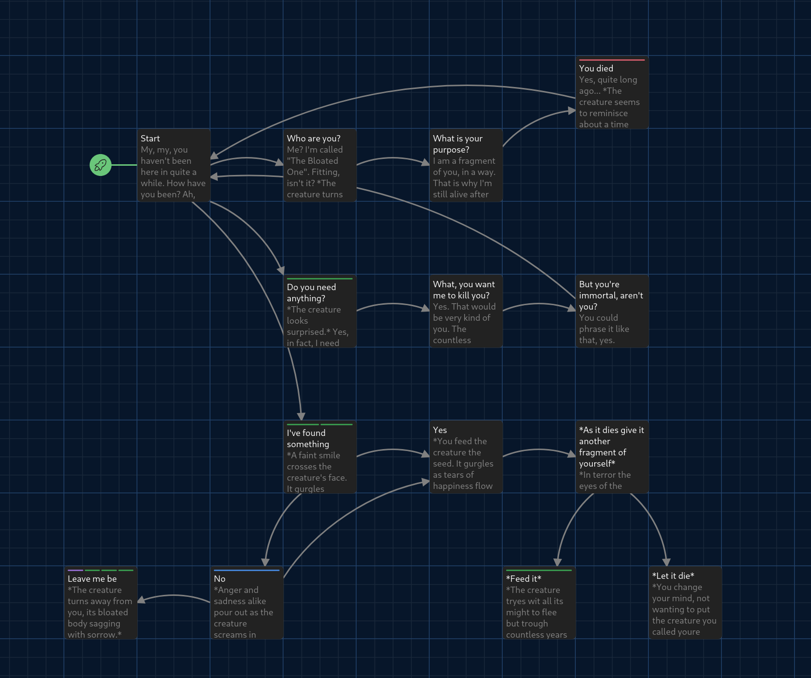

This is an example dialogue. The dialogue can have behaviours assigned to the passages:

| Kind | Tag|
| --- | --- |
|Show the passage only when the condition holds | requires:<item>, if:<flag>, ifnot:<flag>|
|Effects, run once per NPC	| gives:, takes:, item:, organs:, signal:, flag:, unflag:, die|
|Opening passage| start: the first passage tagged start whose conditions hold is where the conversation opens|
## Game

The game starts in a small room. The Player by default is a Rouge called `Whisperbound`.
By consuming one of two corpses in the starting room the player permanently switches class to

- **Fighter**: Gorebound
- **Mage**: Helixbound
- **Rouge**: Whisperbound *Default*


The player has a stats panel with various stats.


The player can hover over various things in the world and get a hover over text. Depending on length
its displayed at cursor or one of the corners.


### Classes

The Whisperbound (Rouge) has a stamina bar. This bar allows the player to move
and press shift to "sprint". Now instead of 1 tile the player moves in a two tile
pattern.

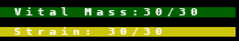

The Gorebound (Fighter), has the Mass bar. While consuming various things in the tower
the mass gets accumulated. This mass 

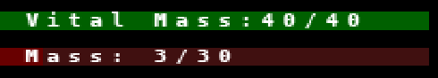

Gaining a mass level influences max HP by a mod of Mass_Level * 4 and
damage_reduction =+ Mass_Level

```python
self.max_hp += self.mass_level * 4
self.damage_reduction += self.mass_level
```

The Helixbound (Mage), gains mana. This mana can be spent by casting spells. The mage
starts with no spells but can by consuming spell scrolls learn them and use them permanently.
(These values for learning need tweaking and don't feal good at this moment.)

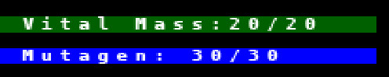


### Equipments

If the player equips some stuff there is a separat Equipment screen where all slots and equipped items with corresponding stat changes are displayed. 

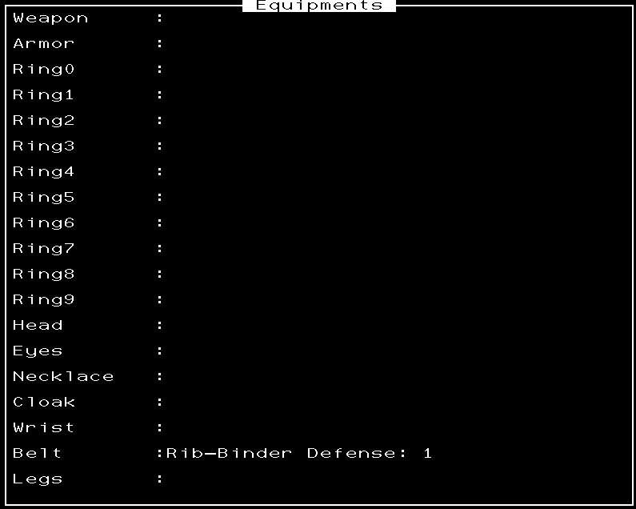